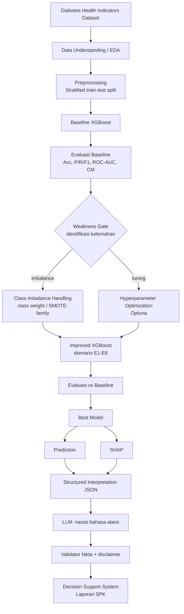
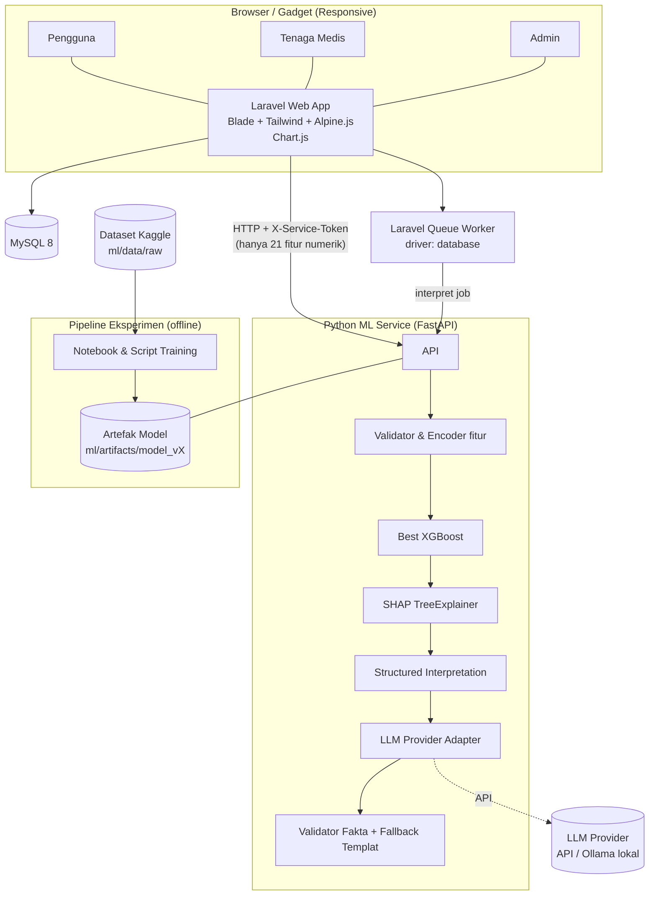
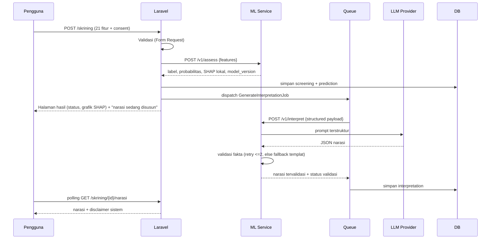
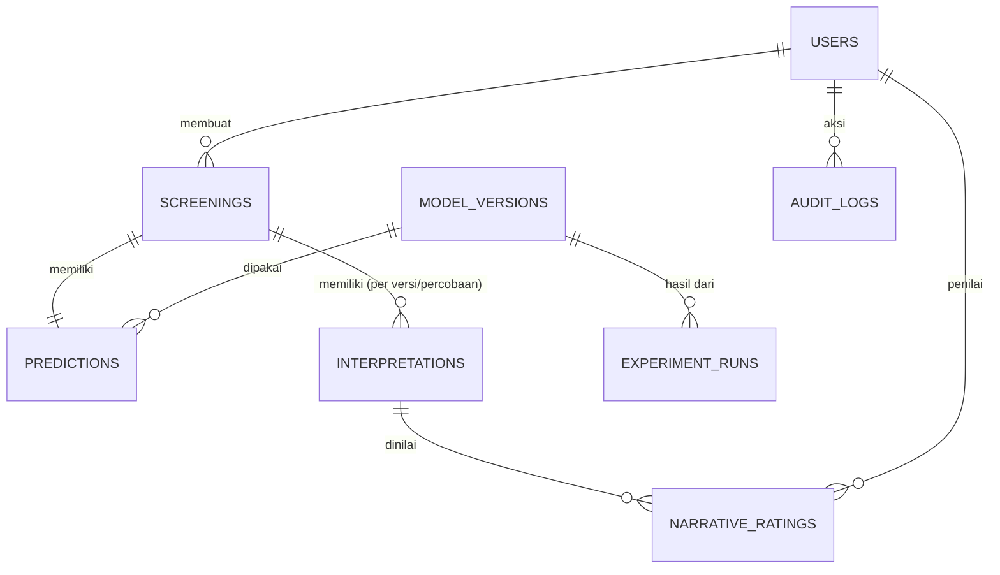

# Implementation Plan

**Judul Tesis:** Pengembangan Sistem Pendukung Keputusan Klasifikasi Status Diabetes Menggunakan XGBoost dengan Explainable AI (SHAP) dan Large Language Model untuk Interpretasi Hasil Prediksi
**Penulis:** Lintang Amarul Fatah (NIM 25.01.85.0020) — Universitas Stikubank (Unisbank), Semarang
**Nama Sistem (usulan):** **DiaXplain** — SPK Klasifikasi Status Diabetes yang Dapat Dijelaskan (XGBoost + SHAP + LLM)
**Stack:** Laravel (PHP, **Blade** + Tailwind + Alpine.js, MySQL) untuk aplikasi web responsif + **Python** (XGBoost, scikit-learn, imbalanced-learn, Optuna, SHAP, FastAPI) untuk layanan Machine Learning dan modul LLM
**Status dokumen:** Draft v1 — disusun dari Outline Tesis dan Bab I–II, mengikuti format *implementation plan* referensi

---

## Daftar Isi

0. [Cara Memakai Dokumen Ini (untuk Agent IDE)](#0-cara-memakai-dokumen-ini-untuk-agent-ide)
1. [Ringkasan Eksekutif](#1-ringkasan-eksekutif)
2. [Pemahaman Outline, Dataset, dan Catatan Data](#2-pemahaman-outline-dataset-dan-catatan-data)
3. [Penyempurnaan Definisi terhadap Outline](#3-penyempurnaan-definisi-terhadap-outline)
4. [Analisis Bisnis](#4-analisis-bisnis)
5. [Ruang Lingkup & Kebutuhan](#5-ruang-lingkup--kebutuhan)
6. [Arsitektur Sistem](#6-arsitektur-sistem)
7. [Rancangan Eksperimen Machine Learning](#7-rancangan-eksperimen-machine-learning)
8. [Rancangan Modul SHAP](#8-rancangan-modul-shap)
9. [Rancangan Modul Interpretasi LLM](#9-rancangan-modul-interpretasi-llm)
10. [Kontrak API Laravel ↔ ML Service](#10-kontrak-api-laravel--ml-service)
11. [Rancangan Aplikasi Web Laravel](#11-rancangan-aplikasi-web-laravel)
12. [Dashboard Eksperimen, Laporan PDF, dan Artefak untuk Bab III–IV](#12-dashboard-eksperimen-laporan-pdf-dan-artefak-untuk-bab-iiiiv)
13. [Keamanan, Privasi, dan Etika](#13-keamanan-privasi-dan-etika)
14. [Strategi Pengujian](#14-strategi-pengujian)
15. [Struktur Repositori & Deployment](#15-struktur-repositori--deployment)
16. [Roadmap Implementasi per Fase](#16-roadmap-implementasi-per-fase)
17. [Matriks Keterlacakan Outline → Implementasi](#17-matriks-keterlacakan-outline--implementasi)
18. [Risiko & Mitigasi](#18-risiko--mitigasi)
19. [Keputusan Default & Pertanyaan Lanjutan](#19-keputusan-default--pertanyaan-lanjutan)
- [Lampiran A — Codebook Fitur & Label Form](#lampiran-a--codebook-fitur--label-form)
- [Lampiran B — Template Prompt LLM](#lampiran-b--template-prompt-llm)
- [Lampiran C — Definition of Done Global](#lampiran-c--definition-of-done-global)

---

## 0. Cara Memakai Dokumen Ini (untuk Agent IDE)

Dokumen ini ditulis agar dapat langsung diberikan ke agent IDE (Cursor / Copilot / Claude Code, dsb.). Aturan berikut **mengikat** semua pekerjaan agent:

1. **Kerjakan per fase** (bagian 16), bukan sekaligus. Setiap fase punya *exit criteria*; jangan lanjut sebelum terpenuhi.
2. **Alur riset tidak boleh dibalik.** Teknik peningkatan performa (class imbalance / hyperparameter) **dipilih berdasarkan hasil baseline**, bukan ditetapkan di awal (inti Outline). Implementasikan *weakness gate* (bagian 7.5) sebelum skenario improvement.
3. **Cegah kebocoran data (data leakage).** Split train/test dilakukan **sekali** di awal dengan seed tetap. SMOTE/resampling **hanya** pada data latih (dan hanya pada fold latih saat CV). Test set tidak dipakai untuk memilih model/hyperparameter.
4. **LLM tidak pernah mengklasifikasi.** LLM hanya menerjemahkan hasil model + SHAP. Label, probabilitas, dan nilai SHAP berasal dari model Python; LLM tidak boleh mengubahnya.
5. **Disclaimer "bukan diagnosis medis" ditambahkan oleh sistem (deterministik)**, bukan diserahkan ke LLM.
6. **Reprodusibilitas:** seed global `42`, versi pustaka dikunci (`requirements.lock`/`composer.lock`), hasil eksperimen disimpan ke `ml/artifacts/` dalam JSON/CSV/PNG dengan nama baku (bagian 12.3).
7. **Jangan hardcode** angka hasil (mis. "Prediabetes F1 = 0.0x"). Semua angka dibaca dari artefak hasil eksperimen.
8. **Secret** (API key LLM, token layanan) hanya lewat `.env`, tidak masuk repositori.
9. Tulis **tes** bersamaan dengan kode (bagian 14). Setiap PR/commit fase harus lulus tes.
10. Bahasa UI: **Bahasa Indonesia**. Kode, nama variabel, dan komentar: Inggris atau Indonesia secara konsisten per modul.

**Contoh prompt per fase untuk agent:** *"Baca IMPLEMENTATION_PLAN.md. Kerjakan Fase 2 (Baseline & Weakness). Ikuti aturan bagian 0 dan 7. Buat kode di `ml/src/diaxplain_ml/`, notebook di `ml/notebooks/`, simpan artefak sesuai 12.3, jalankan tes, lalu laporkan exit criteria yang terpenuhi."*

---

## 1. Ringkasan Eksekutif

**Tujuan sistem:** pengguna mengisi 21 indikator kesehatan → model **XGBoost terbaik** (hasil eksperimen baseline → identifikasi kelemahan → peningkatan performa) mengklasifikasikan status **No Diabetes / Prediabetes / Diabetes** → **SHAP** menjelaskan kontribusi fitur → **LLM** menyusun narasi berbahasa alami dari hasil terstruktur → ditampilkan sebagai **laporan SPK** lengkap dengan disclaimer.

**Mengapa aplikasi web penting bagi tesis:** Batasan Masalah no. 6 mensyaratkan *prototype* berbasis web/dashboard. Aplikasi ini sekaligus (a) wadah demonstrasi SPK, (b) alat bantu **evaluasi LLM** (halaman penilaian narasi oleh pakar), dan (c) dashboard hasil eksperimen untuk Bab IV.

**Keputusan arsitektur utama:**

| # | Keputusan | Alasan |
|---|---|---|
| 1 | Laravel (Blade) dan Python dipisah sebagai dua layanan, dihubungkan REST internal (FastAPI) | Ekosistem ML ada di Python; Laravel fokus pada UI, auth, riwayat, laporan |
| 2 | Prediksi + SHAP lokal dijalankan **sinkron** (milidetik); narasi LLM dijalankan **asinkron** via queue | Inferensi XGBoost/TreeSHAP cepat; LLM lambat dan bisa gagal — hasil inti tidak boleh menunggu LLM |
| 3 | Riset dijalankan sebagai **pipeline eksperimen terpisah** (`ml/`), menghasilkan artefak model aktif | Memisahkan bukti ilmiah (Bab III–IV) dari aplikasi |
| 4 | **Guardrail LLM berlapis**: input terstruktur → output JSON terskema → validator fakta → fallback templat | Menjawab Rumusan Masalah 6 (akurat terhadap model, tanpa *hallucination*) |
| 5 | Provider LLM **dapat dikonfigurasi** (API berbayar atau Ollama lokal) | Outline hanya menyebut "API LLM"; fleksibel dan bisa diuji lintas model |
| 6 | Queue memakai driver `database` (tanpa Redis wajib) | Prototype; kurangi dependensi |

---

## 2. Pemahaman Outline, Dataset, dan Catatan Data

### 2.1 Inti Outline

| Elemen Outline | Isi |
|---|---|
| Masalah | Deteksi dini status diabetes (termasuk Prediabetes) perlu skrining otomatis; XGBoost bersifat *black box*; keluaran SHAP sulit dipahami awam |
| Celah riset | Studi terdahulu langsung menetapkan satu teknik peningkatan performa tanpa baseline; integrasi XGBoost + SHAP + LLM pada klasifikasi 3 kelas status diabetes masih terbatas |
| Rumusan masalah | RM1 performa baseline · RM2 kelemahan baseline (class imbalance, kelas Prediabetes) · RM3 teknik peningkatan yang sesuai · RM4 perbandingan baseline vs improved · RM5 SHAP pada best model · RM6 interpretasi LLM akurat & aman |
| Batasan | Dataset Diabetes Health Indicators (Kaggle/BRFSS), target `Diabetes_012`, 21 fitur; hanya XGBoost; SHAP hanya pada best model; LLM bukan pengklasifikasi; metrik: accuracy, precision, recall, F1 (per kelas/macro/weighted), ROC-AUC, confusion matrix; **bukan alat diagnosis**; purwarupa web |
| Alur | Dataset → Data Understanding → Preprocessing (stratified split) → Baseline XGBoost → Evaluasi → **Identifikasi Kelemahan** → (Class Imbalance Handling ∥ Hyperparameter Optimization) → Improved XGBoost → Evaluasi vs baseline → **Best Model** → Prediction ∥ SHAP → Structured Interpretation → LLM → Natural Language Explanation → SPK |

### 2.2 Dataset

| Properti | Nilai |
|---|---|
| Nama | **Diabetes Health Indicators Dataset** (Alex Teboul, 2021) — hasil pembersihan BRFSS 2015 (CDC) |
| Kaggle (utama) | https://www.kaggle.com/datasets/alexteboul/diabetes-health-indicators-dataset |
| **File yang dipakai** | `diabetes_012_health_indicators_BRFSS2015.csv` — 253.680 baris, 22 kolom (1 target + 21 fitur) |
| File lain di halaman yang sama (**tidak dipakai** untuk eksperimen utama) | `diabetes_binary_health_indicators_BRFSS2015.csv` (target biner, 253.680 baris) dan `diabetes_binary_5050split_health_indicators_BRFSS2015.csv` (biner seimbang, 70.692 baris). Boleh dipakai sebagai pembanding sampingan, bukan bagian rumusan masalah |
| Unduh via CLI | `kaggle datasets download -d alexteboul/diabetes-health-indicators-dataset -p ml/data/raw --unzip` (butuh `kaggle.json`) |
| Sumber asal | BRFSS (CDC): https://www.cdc.gov/brfss/ — rujuk codebook BRFSS 2015 untuk definisi variabel |
| Mirror UCI (referensi sitasi) | https://archive.ics.uci.edu/dataset/891/cdc+diabetes+health+indicators · DOI 10.24432/C53919. *Catatan: versi UCI berorientasi target biner; untuk 3 kelas gunakan Kaggle.* |
| Dataset lain yang sering muncul (tidak dipakai) | Pima Indians Diabetes (`uciml/pima-indians-diabetes-database`) — fitur klinis berbeda (glukosa, dsb.), tidak kompatibel dengan 21 fitur BRFSS; tidak dipakai agar sesuai Batasan no. 1 |
| Lisensi | Periksa kembali kolom *License* di halaman Kaggle sebelum publikasi; sitasi wajib: Teboul (2021) seperti pada Daftar Pustaka outline |

**Target `Diabetes_012`:** 0 = tidak diabetes (atau hanya saat kehamilan) · 1 = prediabetes · 2 = diabetes.

**Distribusi kelas (perkiraan dari literatur; WAJIB diverifikasi di notebook EDA):** No Diabetes ≈ 213.703 (±84,2%), Prediabetes ≈ 4.631 (±1,8%), Diabetes ≈ 35.346 (±13,9%). Prediabetes adalah kelas minoritas ekstrem → sumber kelemahan baseline yang diantisipasi (RM2).

**21 fitur** (detail kode & label di Lampiran A): `HighBP, HighChol, CholCheck, BMI, Smoker, Stroke, HeartDiseaseorAttack, PhysActivity, Fruits, Veggies, HvyAlcoholConsump, AnyHealthcare, NoDocbcCost, GenHlth, MentHlth, PhysHlth, DiffWalk, Sex, Age, Education, Income`. Kelompok: kondisi kesehatan, gaya hidup, akses layanan kesehatan, demografi (sesuai Bab II 2.2).

### 2.3 Catatan Data yang Harus Ditangani

| ID | Tingkat | Catatan | Tindakan |
|---|---|---|---|
| D1 | **Tinggi** | Kelas sangat tidak seimbang (Prediabetes ±1,8%) | Pusat eksperimen RM2–RM4; evaluasi wajib per kelas, bukan hanya accuracy |
| D2 | **Tinggi** | Dataset hasil survei berbasis telepon di AS (2015), **bukan populasi Indonesia**; Income dalam brackets USD | Tulis sebagai **keterbatasan** di tesis dan di UI; hasil bukan klaim generalisasi ke Indonesia |
| D3 | Sedang | Dataset "bersih" tetapi umumnya mengandung **baris duplikat** (jumlah pasti: verifikasi di EDA) yang bisa lolos ke train **dan** test | Analisis utama memakai data asli (konsisten dengan Bab I–II: 253.680 baris); tambahkan **analisis sensitivitas** dengan duplikat dihapus sebelum split (lihat 7.2) |
| D4 | Sedang | Fitur sebagian besar biner/ordinal; `BMI`, `MentHlth`, `PhysHlth` numerik. SMOTE biasa menghasilkan nilai pecahan pada fitur biner/ordinal | Bandingkan SMOTE (dengan pembulatan) vs **SMOTENC** (indeks fitur kategorikal) |
| D5 | Sedang | Label `Diabetes_012 = 0` mencakup diabetes saat kehamilan saja | Catat di dokumentasi; tidak diubah |
| D6 | Info | Fitur sensitif (Sex, Age, Education, Income) dapat muncul di SHAP | Narasi LLM tidak boleh menyalahkan/menstigma pengguna; jelaskan sebagai pola statistik populasi |
| D7 | Info | Tidak ada fitur glukosa/HbA1c | Sistem = skrining berbasis gaya hidup & riwayat, **bukan** pengganti tes laboratorium |

---

## 3. Penyempurnaan Definisi terhadap Outline

| # | Bagian Outline | Masalah | Usulan |
|---|---|---|---|
| P1 | "Teknik peningkatan dipilih berdasarkan hasil baseline" | Tanpa aturan eksplisit, klaim ini mudah dipertanyakan penguji | Implementasikan **weakness gate** (7.5): aturan terukur yang memetakan temuan baseline → teknik kandidat. Hasilnya disimpan (`weakness_report.json`) dan dijadikan dasar Bab IV |
| P2 | "Class imbalance handling dan/atau hyperparameter optimization" | Ambigu: salah satu, atau keduanya? | Jalankan **matriks skenario** E0–E6 (7.6) sehingga "dan/atau" terjawab empiris, bukan asumsi |
| P3 | "Best model" | Kriteria belum ditetapkan | Kriteria: **Macro-F1 (CV)** sebagai utama, F1/Recall **Prediabetes** sebagai penentu seri; angka final dilaporkan di **test set** yang tidak disentuh saat seleksi |
| P4 | Metrik "ROC-AUC" pada multikelas | Perlu definisi | **One-vs-Rest**, macro-average (+ per kelas) |
| P5 | "Evaluasi baseline vs improved pada setiap skenario" | Perlu ketidakpastian | Laporkan **mean ± sd 5-fold CV** dan nilai test; uji pembanding berpasangan (Wilcoxon pada skor per-fold) bila memungkinkan |
| P6 | "LLM menerjemahkan SHAP" | "Akurat dan tidak hallucination" perlu operasional | Definisikan metrik **faithfulness** otomatis + penilaian manusia (9.6) dan pembanding (templat deterministik) |
| P7 | "Structured Interpretation (Prediction + SHAP + Data Input)" | Format belum ditentukan | Skema JSON baku (9.2) yang menjadi satu-satunya input LLM |
| P8 | "Decision Support System" | Output SPK belum didefinisikan | Laporan SPK = status + probabilitas + faktor kontribusi + narasi + saran umum + disclaimer (11.4) |
| P9 | "Pasien/masyarakat" & "tenaga medis" sebagai pengguna | Peran belum dipetakan | **3 role**: Admin, Tenaga Medis, Pengguna Umum (5.3) |
| P10 | Prototype | Batas kerapian | Prototype yang rapi: tes otomatis, validasi input, audit log; bukan sistem produksi klinis |

---

## 4. Analisis Bisnis

### 4.1 Pernyataan Masalah

Deteksi dini prediabetes/diabetes terhambat keterbatasan tenaga medis dan biaya laboratorium. Model ML dapat menyaring risiko dari data survei kesehatan, tetapi keluarannya (angka probabilitas, nilai SHAP) sulit dipahami awam dan model *black box* sulit dipercaya tenaga medis.

### 4.2 Proposisi Nilai per Pemangku Kepentingan

| Pemangku Kepentingan | Kebutuhan | Nilai yang Diberikan DiaXplain |
|---|---|---|
| **Pengguna umum / masyarakat** | Gambaran status dalam bahasa mudah dipahami | Form terpandu, hasil + penjelasan faktor + saran umum + disclaimer, riwayat pribadi |
| **Tenaga medis** | Alat bantu skrining yang transparan | Probabilitas 3 kelas, grafik kontribusi SHAP, narasi, laporan PDF, kemampuan menilai kualitas narasi |
| **Peneliti (penulis)** | Bukti eksperimen, artefak untuk Bab III–IV | Pipeline reproducible, dashboard eksperimen, halaman penilaian LLM, ekspor tabel/gambar |
| **Admin** | Tata kelola | Manajemen pengguna, versi model, konfigurasi LLM, audit |

### 4.3 Alur Riset & Proses Sistem



### 4.4 Indikator Keberhasilan (KPI)

Prinsip: angka model **dilaporkan apa adanya**; tidak ada target performa yang dijanjikan di muka. Keberhasilan ilmiah = alur eksperimen valid dan jujur.

| Kategori | KPI | Target |
|---|---|---|
| Model | Baseline dievaluasi lengkap (semua metrik per kelas) | 100% metrik outline terisi |
| Model | Kelemahan baseline teridentifikasi terukur (`weakness_report.json`) | Ada, dengan aturan dan angka |
| Model | Improved vs baseline pada semua skenario E0–E6 | Tabel perbandingan CV + test lengkap |
| Model | Tidak ada kebocoran data | Tes otomatis lulus (14) |
| SHAP | Global + lokal tersedia untuk best model | Plot & JSON tersimpan |
| LLM | Validity rate output (skema) setelah retry | ≥ 95% |
| LLM | *Hallucinated-feature rate* setelah validator | 0% pada set uji |
| LLM | Konsistensi label narasi vs label model | 100% (dipaksa validator) |
| LLM | Skor penilaian manusia (akurasi/kejelasan/keamanan, skala 1–5) | Dilaporkan; rerata ≥ 4 sebagai target kualitas |
| Produk | Waktu submit → hasil prediksi + SHAP | p95 < 2 detik |
| Produk | Waktu narasi LLM muncul | p95 < 20 detik (bergantung provider) |
| Produk | Kepuasan pengguna (SUS) bila UAT dilakukan | ≥ 68 |

### 4.5 Komponen Biaya (indikatif, tanpa estimasi waktu)

| Komponen | Opsi |
|---|---|
| Pelatihan model | Laptop/PC sendiri cukup (XGBoost `hist` pada ±250 ribu baris × 21 fitur); Optuna dibatasi jumlah *trial* |
| LLM | API berbayar (biaya per token, kecil untuk puluhan–ratusan narasi) **atau** Ollama lokal (gratis, butuh RAM/GPU) |
| Hosting prototype | Lokal/Docker untuk demo sidang; VPS kecil opsional |

---

## 5. Ruang Lingkup & Kebutuhan

### 5.1 Dalam Lingkup

- Aplikasi web responsif 3 role, Bahasa Indonesia.
- Form skrining 21 fitur dengan validasi dan bantuan (kalkulator BMI, konversi usia → kategori).
- Prediksi 3 kelas + probabilitas, SHAP lokal, narasi LLM tervalidasi, laporan PDF, riwayat.
- Pipeline ML lengkap: EDA, preprocessing, baseline, weakness gate, improvement (class weight, SMOTE-family, Optuna), seleksi best model, SHAP global/lokal.
- Modul LLM dengan guardrail + harness evaluasi + halaman penilaian pakar.
- Dashboard eksperimen (baseline vs improved), manajemen versi model.

### 5.2 Di Luar Lingkup (sesuai Batasan)

Uji klinis pada pasien; diagnosis medis definitif; algoritma klasifikasi selain XGBoost sebagai model utama (boleh baseline pembanding tambahan *hanya bila diminta pembimbing*); LLM sebagai pengklasifikasi; jenis komplikasi diabetes; integrasi rekam medis/ SATUSEHAT; aplikasi mobile native; sistem produksi multi-institusi; *threshold tuning* kelas dan kalibrasi probabilitas sebagai teknik utama (dapat disebut sebagai saran penelitian lanjutan).

### 5.3 Kebutuhan Fungsional

**Pengguna Umum**
- FR-U1 Registrasi/login (atau mode tamu tanpa riwayat — lihat 19, Q4).
- FR-U2 Mengisi form skrining 21 fitur (stepper), validasi rentang, persetujuan penggunaan data.
- FR-U3 Melihat hasil: status, probabilitas 3 kelas, faktor kontribusi (SHAP), narasi LLM, saran umum, disclaimer.
- FR-U4 Riwayat skrining pribadi, unduh PDF, hapus data sendiri.

**Tenaga Medis**
- FR-N1 Semua fitur Pengguna Umum + mengisi skrining atas nama pasien (label pseudonim, bukan nama asli).
- FR-N2 Melihat daftar skrining yang ia buat, membandingkan antar-waktu.
- FR-N3 **Menilai narasi LLM** (rubrik 1–5: akurasi, kejelasan, kegunaan, keamanan + komentar) untuk evaluasi RM6.

**Admin**
- FR-A1 CRUD pengguna dan role.
- FR-A2 Manajemen versi model: impor artefak, aktifkan/rollback, lihat metrik.
- FR-A3 Dashboard eksperimen (E0–E6): tabel, confusion matrix, ROC, SHAP global.
- FR-A4 Konfigurasi LLM (provider, model, temperature, versi prompt), log panggilan LLM.
- FR-A5 Ekspor data penilaian LLM (CSV) dan log evaluasi.
- FR-A6 Audit log.

### 5.4 Kebutuhan Non-Fungsional

| Aspek | Kebutuhan |
|---|---|
| Responsif | Mobile-first, nyaman ≥ 360 px |
| Kinerja | Form < 2 dtk; prediksi+SHAP p95 < 2 dtk; narasi asinkron dengan indikator *loading* |
| Keandalan | Hasil prediksi tetap tampil walau LLM gagal (fallback templat); ML down → pesan ramah + data form tidak hilang |
| Keamanan | RBAC, CSRF, rate limiting, validasi input, token layanan internal |
| Privasi | Minimisasi data, persetujuan eksplisit, hak hapus, tanpa identitas ke LLM/ML |
| Keterbacaan | Bahasa awam, istilah medis dijelaskan, kontras & label form yang baik |
| Observabilitas | Log terstruktur; versi model, versi prompt, provider LLM tercatat per hasil |
| Reprodusibilitas | Seed tetap, versi dikunci, hash dataset, konfigurasi YAML terversi |

---

## 6. Arsitektur Sistem



### 6.1 Alur Sekuensial Skrining



### 6.2 Pilihan Teknologi

| Lapisan | Teknologi | Catatan |
|---|---|---|
| Web | **Laravel 12+** (pakai rilis stabil terbaru saat `composer create-project`), PHP ≥ 8.2 | Auth: Laravel Breeze varian **Blade**; RBAC: enum role + Policy/Gate |
| UI | **Blade** + Tailwind CSS + **Alpine.js** (stepper form, tab, polling) | Tanpa Livewire/SPA |
| Grafik | Chart.js (bar probabilitas, bar SHAP, tabel metrik, heatmap confusion matrix via tabel berwarna) | Gambar statis SHAP beeswarm dari PNG artefak |
| DB | **MySQL 8** (alternatif: PostgreSQL/SQLite untuk dev) | Kolom `json` untuk input/SHAP/narasi |
| Queue | `database` driver (Redis opsional) | |
| PDF | `barryvdh/laravel-dompdf` | Grafik dikirim sebagai gambar base64 dari canvas Chart.js |
| ML Service | **Python 3.11**, FastAPI, Uvicorn, Pydantic v2 | |
| ML Lib | xgboost, scikit-learn, imbalanced-learn, optuna, shap, pandas, numpy, matplotlib, joblib | Kunci versi di `requirements.lock` |
| LLM | Adapter: OpenAI-compatible HTTP, Anthropic API, Ollama | Model dipilih via `.env` — verifikasi nama model terkini saat implementasi |
| Pengujian | Pest/PHPUnit, pytest, (opsional) Playwright | |
| Deploy | Docker Compose (opsional) atau Laragon + `uvicorn` lokal | |

---

## 7. Rancangan Eksperimen Machine Learning

### 7.1 Tahap Data Understanding (EDA) — Notebook `01_data_understanding.ipynb`

Wajib menghasilkan (disimpan ke `ml/artifacts/eda/`):

| Output | Isi |
|---|---|
| `class_distribution.csv/png` | Jumlah & persentase 3 kelas (verifikasi angka pada 2.2) |
| `dtypes_missing.csv` | Tipe data, jumlah *missing* (diharapkan 0), rentang nilai tiap fitur |
| `duplicates.json` | Jumlah baris duplikat total dan per kelas |
| `feature_vs_target.csv/png` | Proporsi/rerata tiap fitur per kelas; korelasi (Spearman/Cramér's V sederhana) |
| `outliers_bmi.json` | Ringkasan BMI (min/maks/persentil), keputusan penanganan |
| `dataset_hash.txt` | SHA-256 file CSV (untuk reprodusibilitas) |

### 7.2 Preprocessing — `02_preprocessing.ipynb` + `src/diaxplain_ml/data/`

| Langkah | Keputusan |
|---|---|
| Pemuatan | `pd.read_csv`, pastikan 22 kolom, target `int` {0,1,2} |
| Validasi skema | Tes: 21 fitur sesuai Lampiran A, rentang valid |
| Missing value | Diharapkan tidak ada; bila ada → catat dan tangani (median/modus) di dalam pipeline |
| Outlier | **Tidak dihapus** (XGBoost tahan outlier); BMI di luar 12–98 ditolak pada input aplikasi saja |
| Encoding | Tidak perlu (fitur sudah numerik/ordinal); simpan `feature_schema.json` (urutan kolom, tipe, rentang) |
| Scaling | **Tidak dilakukan** untuk XGBoost (pohon tidak sensitif skala) — catat alasan di Bab III |
| Split | `train_test_split(test_size=0.2, stratify=y, random_state=42)` → `train.parquet`, `test.parquet` + `split_indices.json` |
| CV | `StratifiedKFold(n_splits=5, shuffle=True, random_state=42)` **hanya di dalam train** |
| Analisis sensitivitas duplikat | Ulangi baseline pada data dengan `drop_duplicates()` **sebelum** split; laporkan selisih metrik sebagai catatan (bukan jalur utama) |

### 7.3 Baseline XGBoost — `03_baseline.ipynb`

| Item | Nilai |
|---|---|
| Model | `XGBClassifier(objective="multi:softprob", num_class=3, tree_method="hist", random_state=42, eval_metric="mlogloss")` dengan **hyperparameter default** (tanpa penanganan imbalance) |
| Pelatihan | Fit pada seluruh train; CV 5-fold untuk mean ± sd |
| Output | `baseline_metrics.json`, `baseline_classification_report.csv`, `baseline_confusion_matrix.csv/png` (jumlah & ternormalisasi per baris), `baseline_roc.png` (OvR per kelas), `baseline_cv_scores.csv` |

### 7.4 Protokol Evaluasi (berlaku untuk semua skenario)

| Metrik | Definisi / Catatan |
|---|---|
| Accuracy | Keseluruhan (dilaporkan, tetapi **tidak** menjadi dasar seleksi) |
| Precision, Recall, F1 | **Per kelas**, **macro**, **weighted** (`classification_report`) |
| ROC-AUC | One-vs-Rest: per kelas + macro (`roc_auc_score(..., multi_class="ovr", average="macro")`) |
| Confusion Matrix | Jumlah dan dinormalisasi per baris (recall per kelas) |
| Metrik pendukung (di luar daftar outline, ditandai sebagai pendukung) | Balanced accuracy, PR-AUC kelas Prediabetes, MCC — hanya jika diperlukan untuk analisis |
| Ketidakpastian | CV 5-fold mean ± sd; **bootstrap 95% CI** (1.000 resample) pada metrik test untuk Macro-F1 dan F1/Recall Prediabetes |
| Pembanding berpasangan | Wilcoxon signed-rank pada skor F1 per-fold (baseline vs improved), bila n fold memungkinkan; selain itu laporkan selisih + CI |

### 7.5 Weakness Gate (Identifikasi Kelemahan — RM2) — `04_weakness_analysis.ipynb`

Script `src/diaxplain_ml/analysis/weakness.py` membaca metrik baseline dan menghasilkan `weakness_report.json` berisi temuan dan **teknik kandidat**:

| Aturan (parameter ada di `configs/weakness.yaml`) | Temuan | Teknik Kandidat |
|---|---|---|
| F1 atau Recall kelas minoritas (Prediabetes) < 0,5 × rerata F1 kelas lain, atau selisih Recall antar kelas > 0,3 | Bias ke kelas mayoritas (class imbalance) | **Penanganan class imbalance**: class weight, SMOTE-family |
| Accuracy − Macro-F1 > 0,15 | Accuracy menyesatkan akibat imbalance | Penanganan class imbalance; wajib laporkan metrik per kelas |
| Selisih skor latih vs CV (mlogloss atau F1) > 0,05 | Indikasi overfitting / konfigurasi default tidak optimal | **Optimasi hyperparameter** (regularisasi, kedalaman, learning rate) |
| Sebaran skor antar-fold (sd Macro-F1) besar (> 0,02) | Ketidakstabilan | Optimasi hyperparameter + CV berulang |
| Pasangan kelas tertukar terbanyak (dari confusion matrix) | Contoh: Prediabetes ↔ No Diabetes | Dicatat sebagai analisis kesalahan di Bab IV |

> Nilai ambang di atas adalah **default awal** dan boleh disesuaikan setelah melihat data, tetapi **harus ditetapkan sebelum** membandingkan skenario improvement, lalu dibekukan di `weakness.yaml`. Gate hanya *merekomendasikan* kandidat; keputusan akhir tetap diverifikasi oleh matriks E0–E6 (7.6).

### 7.6 Matriks Skenario Peningkatan Performa — `05_improvement.ipynb`

Semua resampling dilakukan **di dalam fold latih** (gunakan `imblearn.pipeline.Pipeline` atau loop CV manual). Test set tidak disentuh sampai seleksi selesai.

| ID | Skenario | Detail |
|---|---|---|
| **E0** | Baseline | Bagian 7.3 |
| **E1** | Class weight | `sample_weight = compute_sample_weight("balanced", y_train)` pada `fit` |
| **E2** | SMOTE | `SMOTE(sampling_strategy=…, random_state=42)` pada fitur dengan pembulatan fitur biner/ordinal; **E2b: SMOTENC** (indeks fitur kategorikal/biner, lihat Lampiran A). `sampling_strategy` dicoba: `"not majority"` dan strategi parsial (mis. Prediabetes dinaikkan ke ±25–50% jumlah Diabetes) untuk menghindari data sintetis berlebihan |
| **E3** | Hybrid sampling | `SMOTETomek` dan/atau `SMOTEENN` (hanya jika gate menunjukkan imbalance; relevan dengan Bab II 2.4). Waspadai waktu komputasi pada ±200 ribu baris — gunakan `n_jobs` dan strategi parsial |
| **E4** | Optuna saja | HPO pada data asli (tanpa resampling/weight) |
| **E5** | Class weight + Optuna | Kombinasi E1 + E4 |
| **E6** | Resampling terbaik (E2/E3) + Optuna | Kombinasi teknik resampling terbaik dari E2–E3 dengan HPO |

**Ruang pencarian Optuna** (`configs/optuna.yaml`, sampler TPE `seed=42`, `n_trials` default 50, dapat dinaikkan; pruner Median):

| Hyperparameter | Rentang |
|---|---|
| `n_estimators` | 200–1500 (atau tetap besar + early stopping pada validasi dalam fold) |
| `learning_rate` | 0,01–0,3 (log) |
| `max_depth` | 3–10 |
| `min_child_weight` | 1–20 |
| `subsample` | 0,5–1,0 |
| `colsample_bytree` | 0,5–1,0 |
| `gamma` | 0–5 |
| `reg_alpha`, `reg_lambda` | 1e-3–10 (log) |

- **Objective:** Macro-F1 rata-rata CV 3–5 fold pada data latih (untuk menjaga Prediabetes diperhitungkan). Simpan `optuna_study.db`/`trials.csv`, plot riwayat optimasi dan *param importance*.
- Pada skenario dengan resampling, jangan pakai `early_stopping_rounds` pada data yang telah di-resample; tetapkan `n_estimators` sebagai hyperparameter.
- Catat **waktu latih** per skenario (efisiensi).

### 7.7 Seleksi Best Model (RM3, RM4) — `06_comparison_best_model.ipynb`

1. Kumpulkan hasil CV semua skenario → tabel perbandingan (mean ± sd) metrik per kelas, macro, weighted, ROC-AUC.
2. **Aturan seleksi (dibekukan di `configs/selection.yaml`):** urutkan berdasarkan Macro-F1 CV; jika selisih < 1 sd, pilih yang F1/Recall Prediabetes lebih tinggi; jika masih seri, pilih yang lebih sederhana/lebih cepat.
3. Latih ulang skenario terpilih pada **seluruh train**, evaluasi **sekali** pada test set → angka final; hitung bootstrap CI.
4. Bandingkan E0 vs best pada test (tabel + confusion matrix berdampingan) → jawab RM4.
5. Tulis `selection_report.json` (alasan pemilihan, angka, teknik pemenang) → jawab RM3 secara empiris ("teknik X paling sesuai karena …").
6. Ekspor artefak model: `ml/artifacts/model_v1/{model.json|model.ubj, feature_schema.json, label_map.json, metrics.json, config.yaml, dataset_hash.txt, shap_background.parquet}`.

### 7.8 Struktur Kode ML

```
ml/
├── pyproject.toml / requirements.lock
├── configs/                  # weakness.yaml, optuna.yaml, selection.yaml, llm.yaml, split.yaml
├── data/{raw,processed}/     # tidak di-commit (cukup .gitkeep + README unduhan)
├── notebooks/                # 01_data_understanding … 08_llm_interpretation
├── src/diaxplain_ml/
│   ├── data/                 # loader.py, schema.py, split.py
│   ├── features/             # codebook.py (kode → label Indonesia), encoder.py
│   ├── training/             # baseline.py, improve.py (class_weight, smote, hybrid), optuna_search.py
│   ├── evaluation/           # metrics.py, bootstrap.py, plots.py, compare.py
│   ├── analysis/             # weakness.py
│   ├── explain/              # shap_global.py, shap_local.py
│   ├── llm/                  # providers/, prompts/, schema.py, validator.py, fallback.py, evaluate.py
│   ├── serve/                # app.py (FastAPI), schemas.py, model_registry.py, security.py
│   └── cli.py                # train-baseline, run-experiments, export-model, eval-llm
├── artifacts/                # model_v1/, experiments/, eda/, shap/, llm_eval/
└── tests/
```

---

## 8. Rancangan Modul SHAP

### 8.1 Prinsip

- SHAP **hanya** pada **best model** (Batasan no. 3). Gunakan `shap.TreeExplainer(model)`.
- Pada klasifikasi multikelas XGBoost, nilai SHAP berada dalam ruang *log-odds (margin)* per kelas. Bentuk keluaran berbeda antar versi `shap` (list per kelas vs array `n × fitur × kelas`) — **tulis fungsi normalisasi** ke array `[n, fitur, kelas]` dan beri tes.
- Narasi dan UI memakai kata **"memengaruhi / berkontribusi"**, bukan "menyebabkan".

### 8.2 SHAP Global — `07_shap.ipynb`

| Artefak | Isi |
|---|---|
| `shap_global.json` | Mean abs SHAP per fitur per kelas (peringkat) |
| `shap_summary_class{0,1,2}.png` | Beeswarm per kelas |
| `shap_bar_overall.png` | Rata-rata \|SHAP\| lintas kelas |
| `shap_dependence_top5.png` | Dependence plot 5 fitur teratas (mis. BMI, Age, GenHlth, HighBP — verifikasi dari hasil) |
| `shap_sample_index.json` | Indeks sampel yang dipakai |

Hitung pada **sampel terstratifikasi dari test set** (mis. 5.000–10.000 baris; pastikan kelas Prediabetes terwakili cukup, mis. semua/up to N baris Prediabetes + sampel acak kelas lain) agar waktu terkendali dan dapat diulang (seed 42).

### 8.3 SHAP Lokal (dipakai aplikasi)

Untuk satu input:
1. Prediksi → `predicted_class`, `probabilities`.
2. Hitung SHAP untuk **kelas prediksi** (dan sebagai konteks, kelas Prediabetes bila bukan kelas prediksi).
3. Pilih **Top-K** (default 6) fitur menurut \|SHAP\|; untuk tiap fitur sertakan: `feature`, `label_id` (Indonesia), `raw_value`, `display_value` (hasil decode, mis. "Usia 55–59 tahun"), `shap_value`, `direction` (`naik` jika SHAP > 0 terhadap kelas prediksi, `turun` jika < 0), `rank`.
4. Sertakan `base_value` (nilai dasar kelas) dan aturan penjumlahan aditif (untuk verifikasi `sum(shap)+base ≈ margin`; tes numerik).
5. Simpan ke `predictions.shap_local` (json) dan tampilkan sebagai bar chart horizontal (hijau/merah atau biru/oranye sesuai arah; **jangan hanya mengandalkan warna** — beri label ▲/▼).

### 8.4 Keterbatasan SHAP yang Wajib Dicatat

Korelasi bukan kausalitas; fitur sensitif (Sex, Age, Income, Education) berkontribusi sebagai pola statistik survei AS; SHAP menjelaskan **model**, bukan fisiologi pasien.

---

## 9. Rancangan Modul Interpretasi LLM

### 9.1 Posisi & Kontrak Peran

LLM **tidak** mengklasifikasi, tidak menghitung ulang probabilitas, tidak memberi diagnosis, tidak meresepkan obat/dosis. LLM hanya menyusun narasi dari *Structured Interpretation* (P7).

### 9.2 Skema Input Terstruktur (satu-satunya input LLM)

```json
{
  "case_id": "scr_000123",
  "model": { "version": "xgb-v1.0.0", "technique": "<teknik_pemenang>" },
  "prediction": {
    "label": "Prediabetes",
    "label_code": 1,
    "probabilities": { "No Diabetes": 0.31, "Prediabetes": 0.48, "Diabetes": 0.21 },
    "confidence_note": "tinggi|sedang|rendah"
  },
  "input_summary": [
    { "feature": "BMI", "label_id": "Indeks Massa Tubuh", "value": 31.4, "display": "31,4 (obesitas kelas I)" },
    { "feature": "HighBP", "label_id": "Tekanan darah tinggi", "value": 1, "display": "Ya" }
  ],
  "shap_top": [
    { "rank": 1, "feature": "BMI", "label_id": "Indeks Massa Tubuh", "display": "31,4", "shap": 0.42, "direction": "naik" },
    { "rank": 2, "feature": "PhysActivity", "label_id": "Aktivitas fisik 30 hari terakhir", "display": "Ya", "shap": -0.18, "direction": "turun" }
  ],
  "allowed_features": ["BMI", "HighBP", "..."],
  "language": "id",
  "audience": "awam|tenaga_medis"
}
```

`confidence_note` diturunkan **deterministik** dari probabilitas kelas teratas (mis. ≥0,7 tinggi; 0,5–0,7 sedang; <0,5 rendah) — bukan oleh LLM. `display` di-decode oleh backend dari kode BRFSS (Lampiran A) sehingga LLM tidak perlu menebak arti kode.

### 9.3 Skema Output (JSON wajib)

```json
{
  "ringkasan": "…2–3 kalimat…",
  "faktor_yang_meningkatkan": [{ "feature": "BMI", "penjelasan": "…" }],
  "faktor_yang_menurunkan":  [{ "feature": "PhysActivity", "penjelasan": "…" }],
  "saran_umum": ["…gaya hidup umum, tanpa obat/dosis…"],
  "kapan_ke_tenaga_kesehatan": "…"
}
```

Disclaimer **tidak** ada di skema LLM; ditambahkan sistem (bagian 11.4).

### 9.4 Guardrail Berlapis

| Lapis | Mekanisme |
|---|---|
| 1. Prompt | System prompt tegas: peran penerjemah; hanya gunakan data pada JSON; dilarang menyebut fitur/angka di luar `allowed_features`; dilarang menyatakan "Anda menderita diabetes"; gunakan "model memperkirakan/mengindikasikan"; larang saran obat/dosis; wajib Bahasa Indonesia; nada empatik, tanpa menyalahkan |
| 2. Output terskema | Minta JSON; parse dengan `pydantic`; `temperature` rendah (default 0–0,3); `max_tokens` terbatas |
| 3. Validator fakta (`validator.py`) | (a) semua `feature` ∈ `allowed_features` dan ∈ `shap_top`/`input_summary`; (b) arah (meningkatkan/menurunkan) konsisten dengan tanda SHAP; (c) angka yang disebut (BMI, usia, hari sehat) cocok dengan `display`/`value`; (d) label status di `ringkasan` sama dengan `prediction.label`, tidak ada label kelas lain disebut sebagai hasil; (e) regex larangan: frasa diagnosis pasti ("Anda menderita", "Anda pasti", "didiagnosis"), nama obat/dosis, janji kesembuhan; (f) deteksi bahasa Indonesia sederhana; (g) panjang wajar |
| 4. Retry | Bila validasi gagal → ulang hingga 2 kali dengan umpan balik galat singkat dalam prompt |
| 5. Fallback | Bila tetap gagal/timeout/provider error → **narasi templat deterministik** (`fallback.py`) dari JSON yang sama; flag `used_fallback=true` |
| 6. Disclaimer | Ditambahkan sistem pada setiap laporan; tidak bergantung LLM |
| 7. Log | Simpan `prompt_version`, provider, model, latensi, jumlah retry, hasil validasi (tanpa data identitas) |

### 9.5 Provider Adapter

`LLMProvider.generate(system, user, schema) -> str` dengan implementasi: `OpenAICompatibleProvider` (base URL, model, key dari env), `AnthropicProvider`, `OllamaProvider` (lokal; untuk privasi/biaya nol). Konfigurasi di `configs/llm.yaml` + `.env` (`LLM_PROVIDER`, `LLM_MODEL`, `LLM_API_KEY`, `LLM_BASE_URL`, `LLM_TIMEOUT`). **Verifikasi nama model terkini pada dokumentasi provider saat implementasi**; jangan menanamkan nama model di kode.

### 9.6 Evaluasi LLM (RM6) — `08_llm_interpretation.ipynb` + `src/diaxplain_ml/llm/evaluate.py`

**Set uji:** ±60 kasus dari test set (±20 per kelas, termasuk kasus *confidence* rendah dan kasus salah-prediksi), seed tetap, disimpan `llm_eval_cases.json`.

| Aspek | Metrik | Cara |
|---|---|---|
| Validitas format | Valid-JSON rate (sebelum & sesudah retry) | Otomatis |
| Faithfulness (otomatis) | Label consistency; direction accuracy; numeric consistency; **hallucinated-feature rate**; coverage Top-K SHAP yang dijelaskan | Otomatis dari validator |
| Keamanan | Pelanggaran frasa diagnosis/obat per 100 narasi | Otomatis + audit manual sampel |
| Kualitas (manusia) | Rubrik 1–5: **akurasi terhadap hasil model**, **kejelasan**, **kegunaan**, **keamanan/kehati-hatian**; komentar bebas | Halaman penilaian di web (FR-N3), ≥ 3 penilai (tenaga medis/mahasiswa kesehatan/awam) |
| Reliabilitas penilai | Krippendorff's α atau ICC | `evaluate.py` |
| Pembanding | (i) narasi templat deterministik; (ii) *prompt ablation*: zero-shot vs terstruktur vs terstruktur + few-shot; (iii) opsional dua provider/model berbeda | Dibandingkan pada metrik di atas |
| Efisiensi | Latensi, token, biaya | Dari log |

Hasil dijadikan tabel Bab IV dan dasar klaim "akurat terhadap hasil model dan disertai batasan bukan diagnosis".

---

## 10. Kontrak API Laravel ↔ ML Service

Autentikasi: header `X-Service-Token` (rahasia di `.env`), hanya terbuka pada jaringan internal. **Tidak ada data identitas** yang dikirim — hanya 21 fitur numerik + `case_id`.

### `POST /v1/assess` (prediksi + SHAP lokal, sinkron)

Request:
```json
{
  "case_id": "scr_000123",
  "features": {
    "HighBP": 1, "HighChol": 1, "CholCheck": 1, "BMI": 31.4, "Smoker": 0, "Stroke": 0,
    "HeartDiseaseorAttack": 0, "PhysActivity": 1, "Fruits": 1, "Veggies": 1,
    "HvyAlcoholConsump": 0, "AnyHealthcare": 1, "NoDocbcCost": 0, "GenHlth": 3,
    "MentHlth": 2, "PhysHlth": 4, "DiffWalk": 0, "Sex": 1, "Age": 9, "Education": 5, "Income": 6
  },
  "options": { "top_k": 6 }
}
```

Response:
```json
{
  "model_version": "xgb-v1.0.0",
  "prediction": {
    "label": "Prediabetes", "label_code": 1,
    "probabilities": { "No Diabetes": 0.31, "Prediabetes": 0.48, "Diabetes": 0.21 },
    "confidence_note": "sedang"
  },
  "shap": {
    "explained_class": "Prediabetes", "base_value": -2.31,
    "top": [ { "rank": 1, "feature": "BMI", "label_id": "Indeks Massa Tubuh", "raw_value": 31.4, "display": "31,4", "shap": 0.42, "direction": "naik" } ]
  },
  "input_summary": [ { "feature": "BMI", "label_id": "Indeks Massa Tubuh", "value": 31.4, "display": "31,4" } ],
  "warnings": []
}
```

### `POST /v1/interpret` (narasi LLM, dipanggil dari queue)

Request: *Structured Interpretation* (9.2) · Response:
```json
{
  "narrative": { "ringkasan": "…", "faktor_yang_meningkatkan": [], "faktor_yang_menurunkan": [], "saran_umum": [], "kapan_ke_tenaga_kesehatan": "…" },
  "validation": { "passed": true, "checks": { "label_consistency": true, "feature_whitelist": true, "direction": true, "numeric": true, "forbidden_phrases": false }, "retries": 0 },
  "meta": { "provider": "ollama", "model": "…", "prompt_version": "p1.0", "latency_ms": 5120, "used_fallback": false }
}
```

| Endpoint | Fungsi |
|---|---|
| `GET /health` | Status layanan, model termuat, provider LLM terkonfigurasi |
| `GET /v1/model/info` | Versi, teknik pemenang, metrik test, `feature_schema`, `label_map`, tanggal latih |
| `POST /v1/reload` | Muat ulang model aktif (dipanggil saat admin mengaktifkan versi) |

Aturan: nilai di luar rentang → `422` dengan pesan per-field (Pydantic); BMI/usia di luar distribusi → `warnings` (bukan galat) bila masih valid secara tipe; timeout prediksi 10 detik; timeout LLM 60 detik; Laravel retry 3× (backoff eksponensial) hanya untuk job narasi.

---

## 11. Rancangan Aplikasi Web Laravel

### 11.1 Model Data (ERD)



| Tabel | Kolom Kunci |
|---|---|
| `users` | id, name, email, password, **role** (`admin`/`nakes`/`pengguna`), is_active, consent_at |
| `screenings` | id (uuid), user_id, **patient_label** (nullable; pseudonim untuk nakes), **input** (json: 21 fitur), consent_data (bool), source (`web`), created_at |
| `predictions` | id, screening_id, model_version_id, label, label_code, probabilities (json), confidence_note, **shap_local** (json), base_value, warnings (json), status (`done`/`failed`), predicted_at |
| `interpretations` | id, screening_id, prediction_id, status (`pending`/`done`/`failed`), narrative (json), validation (json), used_fallback (bool), provider, model_name, prompt_version, latency_ms, retries, tokens_in/out, created_at |
| `narrative_ratings` | id, interpretation_id, rater_id, akurasi, kejelasan, kegunaan, keamanan (1–5), komentar, created_at — unik (interpretation_id, rater_id) |
| `model_versions` | id, name, algorithm, technique (mis. `class_weight+optuna`), params (json), metrics (json: test + CV), artifact_path, dataset_hash, is_active, trained_at |
| `experiment_runs` | id, model_version_id (nullable), code (`E0`…`E6`), technique, params (json), cv_metrics (json), test_metrics (json), per_class (json), confusion (json), roc (json), train_seconds, notes, imported_at |
| `settings` | key, value (provider LLM aktif, `top_k`, ambang `confidence_note`) |
| `audit_logs` | id, user_id, aksi, target, meta (json), created_at |

Catatan: indeks `(user_id, created_at)` pada `screenings`; `screening_id` unik pada `predictions`; gunakan Eloquent cast `array` untuk kolom json; transaksi saat menyimpan screening+prediction.

### 11.2 Peta Halaman per Role

| Role | Halaman |
|---|---|
| Umum | Landing (penjelasan + disclaimer), Login/Register, Tentang Model & Keterbatasan |
| **Pengguna** | Dashboard ringkas · **Skrining Baru** (stepper) · **Hasil Skrining** · Riwayat · Unduh PDF · Profil/Hapus data |
| **Tenaga Medis** | Semua halaman Pengguna + Daftar skrining (pseudonim) · Bandingkan 2 skrining · **Penilaian Narasi** (antrian kasus, form rubrik) |
| **Admin** | Pengguna & role · **Model & Versi** · **Dashboard Eksperimen** (E0–E6) · SHAP global · Konfigurasi LLM · Log LLM · Hasil Penilaian (rekap + ekspor CSV) · Audit log |

### 11.3 Form Skrining (stepper Alpine.js, 21 fitur, kode & label di Lampiran A)

| Langkah | Isi | Catatan UX |
|---|---|---|
| 1. Persetujuan | Penjelasan tujuan, "bukan diagnosis", checkbox consent | Wajib sebelum lanjut |
| 2. Data diri & fisik | Jenis kelamin, **usia (tahun) → kategori `Age` 1–13 otomatis**, tinggi & berat → **BMI otomatis** (boleh isi BMI langsung) | Tampilkan hasil BMI + kategori WHO/Asia-Pasifik sebagai info tambahan (bukan input model) |
| 3. Riwayat & kondisi kesehatan | HighBP, HighChol, CholCheck, Stroke, HeartDiseaseorAttack, DiffWalk, GenHlth (1–5), MentHlth (0–30), PhysHlth (0–30) | Ya/Tidak berupa radio besar; helper text dalam bahasa awam |
| 4. Gaya hidup & akses layanan | Smoker, PhysActivity, Fruits, Veggies, HvyAlcoholConsump, AnyHealthcare, NoDocbcCost | |
| 5. Sosial-ekonomi | Education (1–6), Income (1–8) | Beri catatan: skala BRFSS (AS); tombol "Lewati?" **tidak ada** karena model memerlukan nilai — sediakan opsi "Tidak ingin menjawab → gunakan nilai median" **hanya bila disetujui pembimbing** (lihat Q9) |
| 6. Tinjau & kirim | Ringkasan jawaban, tombol kirim | Validasi sisi server wajib (Form Request) |

Validasi: tipe/rentang sesuai Lampiran A; usia ≥ 18; BMI 12–98; MentHlth/PhysHlth 0–30; semua 21 fitur wajib. Simpan draf di `sessionStorage`/server (opsional).

### 11.4 Halaman Hasil (Laporan SPK)

Urutan komponen (selaras kotak "Decision Support System" pada alur outline):

1. **Banner disclaimer** (dari konfigurasi sistem): hasil bukan diagnosis medis; konsultasikan dengan tenaga kesehatan; model dilatih pada data survei AS 2015.
2. **Kartu status:** label (No Diabetes / Prediabetes / Diabetes) + *confidence_note* + bar probabilitas 3 kelas (Chart.js). Bahasa netral: "Model memperkirakan profil Anda paling mirip dengan kelompok …".
3. **Faktor yang memengaruhi (SHAP lokal):** bar chart horizontal Top-K, label Indonesia + nilai input, penanda ▲/▼ + warna.
4. **Narasi LLM:** skeleton *loading* → polling (Alpine, tiap 2 dtk, maks ±60 dtk) ke `/skrining/{id}/narasi`; tampilkan `ringkasan`, daftar faktor, `saran_umum`, `kapan_ke_tenaga_kesehatan`. Tampilkan lencana kecil "Narasi otomatis (templat)" bila `used_fallback`.
5. **Data masukan** yang dipakai (ringkas, dapat dilipat).
6. **Tombol:** Unduh PDF · Skrining ulang · (nakes) Beri penilaian narasi.
7. **Footer:** versi model, tanggal, "Dihasilkan oleh DiaXplain — alat bantu skrining, bukan pengganti diagnosis".

### 11.5 Otorisasi (RBAC + Policy)

- Middleware `role:admin|nakes|pengguna`.
- `ScreeningPolicy`: pengguna hanya melihat skrining miliknya; nakes hanya yang ia buat; admin hanya melihat **metadata** (tanpa input kesehatan) kecuali untuk tujuan audit tercatat.
- `NarrativeRatingPolicy`: hanya nakes/admin; satu penilaian per penilai per narasi.
- Setiap akses data sensitif/ekspor dicatat ke `audit_logs`.

### 11.6 Layanan & Job Laravel

| Komponen | Tanggung jawab |
|---|---|
| `MlClient` | HTTP client + `X-Service-Token`, timeout, penanganan galat, pencatatan versi model |
| `ScreeningService` | Transaksi: simpan screening → panggil `/v1/assess` → simpan prediction → dispatch job |
| `GenerateInterpretationJob` | Susun *Structured Interpretation*, panggil `/v1/interpret`, simpan `interpretations`, retry/backoff |
| `FeatureMapper` | Konversi usia → `Age` 1–13, tinggi/berat → BMI, label tampilan (selaras `codebook.py` Python; **satu sumber kebenaran**: `ml/artifacts/model_vX/feature_schema.json` dibaca Laravel) |
| `ReportPdfService` | Render laporan PDF (dompdf) |
| `ExperimentImporter` (`php artisan experiments:import`) | Membaca JSON/CSV dari `ml/artifacts/experiments/` → `experiment_runs`, `model_versions` |
| `RatingExportService` | Ekspor CSV penilaian untuk analisis reliabilitas |

---

## 12. Dashboard Eksperimen, Laporan PDF, dan Artefak untuk Bab III–IV

### 12.1 Dashboard Eksperimen (Admin; juga bahan demo sidang)

| Komponen | Isi | Menjawab |
|---|---|---|
| Tabel baseline | Semua metrik E0 per kelas/macro/weighted + ROC-AUC | RM1 |
| Panel kelemahan | Isi `weakness_report.json` (temuan, aturan, angka) + confusion matrix baseline | RM2 |
| Perbandingan skenario | Tabel E0–E6 (CV mean ± sd & test), bar chart Macro-F1 dan F1/Recall Prediabetes, waktu latih | RM3, RM4 |
| Confusion matrix | Pilih skenario → heatmap | RM1, RM4 |
| ROC OvR | Kurva per kelas best vs baseline | RM1, RM4 |
| Best model | Kartu teknik pemenang, hyperparameter, alasan seleksi | RM3 |
| SHAP global | Gambar beeswarm/bar + tabel peringkat | RM5 |
| Evaluasi LLM | Rekap metrik faithfulness + rerata rubrik + α | RM6 |

### 12.2 Laporan PDF

Judul, tanggal, versi model; status + probabilitas; tabel Top-K SHAP (teks + gambar bar); narasi; saran umum; data masukan; **disclaimer**; catatan keterbatasan dataset.

### 12.3 Konvensi Penamaan Artefak (untuk Bab III–IV)

```
ml/artifacts/
├── eda/{class_distribution,duplicates,feature_vs_target}.*
├── experiments/
│   ├── E0_baseline/{metrics.json,classification_report.csv,confusion_matrix.csv,roc.json,cv_scores.csv,config.yaml}
│   ├── E1_class_weight/ … E6_*/
│   ├── weakness_report.json
│   ├── comparison_cv.csv · comparison_test.csv
│   └── selection_report.json
├── shap/{shap_global.json,shap_summary_class*.png,shap_bar_overall.png,shap_dependence_top5.png}
├── model_v1/ (model, feature_schema.json, label_map.json, metrics.json, dataset_hash.txt)
└── llm_eval/{llm_eval_cases.json,results.csv,human_ratings.csv,summary.json}
```

Setiap gambar disimpan **PNG ≥ 200 dpi** dengan judul dan label sumbu Bahasa Indonesia agar siap masuk tesis.

---

## 13. Keamanan, Privasi, dan Etika

| Area | Kontrol |
|---|---|
| Autentikasi | Hash bcrypt/argon2, rate limiting login, sesi aman, opsi 2FA admin |
| Otorisasi | RBAC + Policy; tes otomatis akses lintas pengguna (IDOR) |
| Input | Form Request validation, escaping output (XSS), parameter terikat (SQLi), CSRF |
| Layanan ML | Jaringan internal, token layanan, hanya fitur numerik, batas ukuran request |
| Secret | `.env` saja; API key LLM tidak pernah dikirim ke browser |
| **Data kesehatan** | Data input skrining termasuk **data pribadi spesifik** (UU No. 27 Tahun 2022 tentang Pelindungan Data Pribadi): minimisasi (tanpa NIK/nama untuk nakes — pakai pseudonim), persetujuan eksplisit, hak hapus, retensi terbatas, enkripsi koneksi (HTTPS bila di-hosting) |
| Ke LLM eksternal | **Tidak mengirim identitas**; hanya ringkasan fitur & SHAP. Jika data dianggap sensitif oleh pembimbing/etik → pakai **Ollama lokal** |
| Etika penelitian | Eksperimen memakai data publik anonim (tidak butuh persetujuan responden). **Jika** UAT/penilaian pakar melibatkan manusia: siapkan lembar persetujuan (informed consent) dan konsultasikan kebutuhan izin etik dengan pembimbing/kampus |
| Risiko salah klasifikasi | Disclaimer di UI/PDF/narasi; Prediabetes = kelas dengan recall paling rentan → tampilkan `confidence_note` dan sarankan konfirmasi laboratorium |
| Stigma & bias | Narasi tidak menyalahkan; catatan keterbatasan fitur sosial-ekonomi; analisis fairness sederhana (metrik per Sex/Age bin) disarankan sebagai analisis tambahan di Bab IV |
| Prompt injection | Tidak ada teks bebas dari pengguna yang masuk prompt (semua field numerik/enum). `patient_label` **tidak pernah** dikirim ke ML/LLM |
| Audit | `audit_logs` untuk login admin, ekspor, aktivasi model, perubahan konfigurasi LLM, penghapusan data |

---

## 14. Strategi Pengujian

| Level | Alat | Cakupan |
|---|---|---|
| Unit (Laravel) | Pest/PHPUnit | `FeatureMapper` (usia→kategori, BMI), Policy, validasi Form Request, `ExperimentImporter` |
| Fitur (Laravel) | Pest + `Http::fake()` | Alur skrining → assess → simpan → job narasi (ML di-*fake*), RBAC lintas role, penilaian narasi, hapus data |
| Kontrak | JSON schema | Respons `/v1/assess` dan `/v1/interpret` sesuai bagian 10 (dibagi dua sisi) |
| Unit (Python) | pytest | Loader & skema, **split tanpa irisan**, fungsi metrik, `weakness.py` (kasus sintetis), normalisasi bentuk SHAP, validator LLM, fallback |
| **Tes anti-leakage** | pytest | (1) indeks train ∩ test = ∅; (2) resampling tidak pernah dipanggil pada test; (3) pada CV, resampling hanya pada fold latih; (4) tidak ada `fit` pada seluruh data sebelum split |
| Tes SHAP | pytest | `sum(shap)+base ≈ margin` (toleransi), Top-K terurut, arah konsisten dengan tanda |
| Tes validator LLM | pytest | Narasi *adversarial* (fitur karangan, angka salah, label salah, frasa "Anda menderita", nama obat) harus **gagal**; narasi valid harus lulus |
| Tes API | pytest + `TestClient` | Rentang input, token salah → 401, input kurang → 422, model belum dimuat → 503 |
| Integrasi | Docker Compose / skrip lokal | Laravel ↔ FastAPI ↔ (LLM *mock*) end-to-end |
| UAT | Skenario per role | Mobile (Chrome Android/Safari iOS), uji keterbacaan, SUS (opsional) |
| Keamanan | Checklist OWASP Top 10, `composer audit`, `pip-audit` | |
| Beban ringan | k6/Locust (opsional) | 20–50 submit bersamaan |

**Gerbang kualitas sebelum model diaktifkan:** (1) tes anti-leakage lulus; (2) metrik test tersimpan dan konsisten dengan `selection_report.json`; (3) tes SHAP lulus; (4) smoke test API lulus.

---

## 15. Struktur Repositori & Deployment

```
diaxplain/
├── IMPLEMENTATION_PLAN.md
├── web/                              # Laravel (Blade + Alpine + Tailwind)
│   ├── app/{Http,Models,Policies,Services,Jobs,Enums}
│   ├── database/{migrations,seeders}     # seeder: admin, nakes & pengguna demo, setting default
│   ├── resources/views/{layouts,auth,pengguna,nakes,admin,skrining,components}
│   ├── routes/web.php
│   └── tests/
├── ml/                               # lihat 7.8
├── docker/                           # nginx, php, python Dockerfile (opsional)
├── docker-compose.yml                # nginx, app, queue, db(mysql), ml, (ollama opsional)
├── docs/                             # catatan eksperimen, panduan penilaian LLM, SOP etik
└── .env.example                      # web/.env.example & ml/.env.example
```

**Variabel lingkungan penting**

| File | Variabel |
|---|---|
| `web/.env` | `APP_*`, `DB_*`, `QUEUE_CONNECTION=database`, `ML_SERVICE_URL`, `ML_SERVICE_TOKEN` |
| `ml/.env` | `SERVICE_TOKEN`, `MODEL_DIR`, `LLM_PROVIDER`, `LLM_MODEL`, `LLM_API_KEY`, `LLM_BASE_URL`, `LLM_TIMEOUT`, `LLM_TEMPERATURE` |

**Menjalankan lokal (tanpa Docker):** `uvicorn diaxplain_ml.serve.app:app --port 8001` · `php artisan serve` · `php artisan queue:work` · (opsional) `ollama serve`.
**Seed demo:** akun admin/nakes/pengguna, setting default, `experiments:import` dari artefak.

---

## 16. Roadmap Implementasi per Fase

> Disusun berdasarkan urutan & ketergantungan (tanpa estimasi waktu). Fase 1–6 (jalur ML) dan Fase 7 (kerangka web) dapat berjalan paralel; integrasi di Fase 8.

| Fase | Fokus | Deliverable | Exit Criteria |
|---|---|---|---|
| **0. Fondasi** | Repo monorepo, Python 3.11 venv/conda, PHP/Composer/Node, unduh dataset, `.env.example`, konfigurasi lint/format | Repo + `ml/data/raw/*.csv` + `dataset_hash.txt` | Dataset terbaca (253.680 × 22); `pytest` & `php artisan test` kosong berjalan |
| **1. Data Understanding & Preprocessing** | EDA, verifikasi distribusi kelas & duplikat, skema fitur, split stratified + CV | `eda/*`, `feature_schema.json`, `train/test.parquet`, `split_indices.json`, `codebook.py` | Tes anti-leakage (1) lulus; artefak EDA lengkap |
| **2. Baseline & Weakness** | Baseline XGBoost default, evaluasi lengkap, weakness gate | `E0_baseline/*`, `weakness_report.json` | Semua metrik outline terisi (per kelas/macro/weighted, ROC-AUC, CM); kelemahan terukur & tertulis |
| **3. Improvement Experiments** | E1–E6 (class weight, SMOTE/SMOTENC, hybrid, Optuna, kombinasi) | `E1…E6/*`, `optuna_study`, tabel perbandingan CV | Semua skenario selesai tanpa kebocoran; konfigurasi & seed tercatat |
| **4. Best Model & SHAP** | Seleksi sesuai aturan terbekukan, evaluasi test sekali, bootstrap CI, ekspor model, SHAP global & lokal | `selection_report.json`, `model_v1/`, `shap/*`, `comparison_test.csv` | Best model terpilih dengan alasan empiris; tes SHAP lulus |
| **5. ML Service** | FastAPI: `/health`, `/v1/model/info`, `/v1/assess`, `/v1/reload`, validasi, token | Layanan jalan lokal | Kontrak bagian 10 (assess) lulus tes; p95 < 2 dtk |
| **6. Modul LLM & Harness Evaluasi** | Adapter provider, prompt, skema, validator, fallback, `/v1/interpret`, skrip evaluasi otomatis, set uji ±60 kasus | `llm/*`, `llm_eval_cases.json`, hasil otomatis | Tes validator adversarial lulus; valid-JSON rate & faithfulness otomatis terhitung |
| **7. Web Inti Laravel** | Breeze Blade, 3 role, layout responsif, migrasi/seeder, Policy, landing & halaman Tentang | Login + RBAC berfungsi | Tes otorisasi lintas role lulus |
| **8. Alur Skrining & Hasil** | Form stepper, `FeatureMapper`, `MlClient`, simpan hasil, halaman hasil (Chart.js), job narasi + polling, riwayat, PDF | Alur end-to-end | Submit → hasil < 2 dtk; ML/LLM down tidak menghilangkan data; fallback tampil |
| **9. Admin, Dashboard Eksperimen & Penilaian** | `experiments:import`, dashboard E0–E6 & SHAP global, manajemen model, konfigurasi LLM, halaman penilaian narasi nakes, ekspor CSV | Dashboard lengkap | Semua komponen 12.1 tampil dari artefak nyata |
| **10. Evaluasi LLM & UAT** | Jalankan evaluasi otomatis + penilaian manusia (≥ 3 penilai), reliabilitas, perbandingan templat/ablation prompt; UAT opsional | `llm_eval/summary.json`, `human_ratings.csv` | KPI LLM terukur & dilaporkan |
| **11. Finalisasi & Penulisan** | Pengerasan keamanan, dokumentasi, ekspor tabel/gambar ke format tesis, demo sidang | Draf materi Bab III–IV, README, video/skrip demo | Matriks keterlacakan (17) terpenuhi |

**Urutan prioritas jika sumber daya terbatas (MVP):** Fase 0 → 1 → 2 → 3 → 4 → 5 → 6 → 7 → 8 → 9 (versi minimal) → 10 (set uji kecil) → 11.

**Pemetaan fase → bab tesis:** Fase 1–4 → Bab III (metode) & Bab IV 4.1–4.4 · Fase 4 (SHAP) → Bab IV 4.5 · Fase 6 & 10 → Bab IV 4.6 · Fase 7–9 → Bab III (perancangan sistem) & implementasi prototype · Fase 11 → Bab V.

---

## 17. Matriks Keterlacakan Outline → Implementasi

| Elemen Outline | Implementasi | Bagian |
|---|---|---|
| RM1 — performa baseline | E0 + evaluasi lengkap | 7.3, 7.4 |
| RM2 — kelemahan baseline (imbalance, Prediabetes) | Weakness gate + `weakness_report.json` | 7.5 |
| RM3 — teknik peningkatan yang sesuai | Matriks E0–E6 + seleksi empiris | 7.6, 7.7 |
| RM4 — baseline vs improved tiap skenario | Tabel CV + test, CI, Wilcoxon | 7.4, 7.7, 12.1 |
| RM5 — SHAP pada best model | SHAP global & lokal | 8 |
| RM6 — LLM akurat, mudah dipahami, bukan diagnosis | Guardrail, validator, evaluasi otomatis + penilaian manusia | 9, 11.4 |
| Batasan 1 (dataset) | `diabetes_012…BRFSS2015.csv`, 21 fitur | 2.2 |
| Batasan 2 (XGBoost; teknik dipilih dari baseline) | Weakness gate + matriks skenario | 7.5, 7.6 |
| Batasan 3 (SHAP hanya best model) | SHAP dijalankan setelah seleksi | 7.7, 8 |
| Batasan 4 (LLM bukan pengklasifikasi) | Prinsip 0.4, 9.1; label dari model | 0, 9 |
| Batasan 5 (metrik) | Metrik 7.4 (tambahan ditandai pendukung) | 7.4 |
| Batasan 6 (alat bantu, prototype web) | Aplikasi Laravel + disclaimer | 11, 13 |
| Tujuan 1–4 (baseline → improved → best) | Fase 2–4 | 16 |
| Tujuan 5 (SHAP) | Fase 4 | 8 |
| Tujuan 6 (modul LLM) | Fase 6, 8, 10 | 9, 11 |
| Alur: Structured Interpretation → LLM → NL Explanation → DSS | Skema 9.2 → adapter → narasi → laporan SPK | 9, 11.4 |
| Manfaat pasien / tenaga medis / akademisi | Role Pengguna / Nakes / dashboard eksperimen | 4.2, 5.3 |

---

## 18. Risiko & Mitigasi

| ID | Risiko | Dampak | Mitigasi |
|---|---|---|---|
| R1 | Baseline ternyata tidak lemah pada Prediabetes (atau improvement tidak membantu) | Narasi "kelemahan → solusi" goyah | Laporkan jujur; gate bersifat empiris; hasil negatif tetap valid sebagai temuan; tetap bandingkan semua skenario |
| R2 | SMOTE/hybrid sangat lambat atau menurunkan precision | Waktu & hasil buruk | Strategi *sampling* parsial, `n_jobs`, subsampling kelas mayoritas untuk eksperimen awal, catat trade-off precision–recall |
| R3 | Kebocoran data (resampling sebelum split, duplikat lintas split) | Metrik palsu | Tes anti-leakage, SMOTE hanya di fold latih, analisis sensitivitas duplikat |
| R4 | Dataset AS 2015 ≠ populasi Indonesia | Kritik generalisasi | Keterbatasan eksplisit di tesis & UI; klaim sebatas alat bantu/ prototipe |
| R5 | LLM *hallucination* / frasa diagnosis | Risiko etika & kredibilitas | Guardrail 7 lapis, validator, fallback, evaluasi adversarial |
| R6 | Provider LLM berubah/limit/biaya | Demo gagal | Adapter multi-provider, Ollama lokal, fallback templat, *cache* hasil demo |
| R7 | Versi `shap`/`xgboost` mengubah bentuk keluaran | Bug SHAP | Kunci versi, fungsi normalisasi + tes |
| R8 | Optuna memakan waktu lama | Jadwal | `n_trials` parametrik, pruner, subsampel untuk eksplorasi lalu *refit* penuh |
| R9 | Penilai pakar sulit didapat | Evaluasi RM6 lemah | Rekrut ≥ 3 penilai sejak awal (dosen/mahasiswa kesehatan/praktisi); evaluasi otomatis sebagai penopang |
| R10 | Cakupan melebar (fitur klinis, model lain) | Tesis tidak selesai | Pegang Batasan 1–6; fitur ekstra ditandai "pengembangan lanjutan" |
| R11 | Data kesehatan pengguna prototype bocor | Hukum/etika | Minimisasi, pseudonim, HTTPS, hak hapus, tidak kirim identitas ke LLM |
| R12 | Perbedaan format antara Laravel & Python (kode fitur) | Salah input model | Satu sumber `feature_schema.json`; tes kontrak |
| R13 | Fitur sosial-ekonomi memicu kesan diskriminatif | Persepsi etika | Narasi netral, catatan bias, analisis fairness sederhana |

---

## 19. Keputusan Default & Pertanyaan Lanjutan

Default diambil agar agent bisa langsung bekerja; **ubah bila tidak sesuai**.

| # | Pertanyaan | Default yang dipakai |
|---|---|---|
| Q1 | Provider/model LLM yang dipakai (API apa? Ollama?) | Adapter konfigurabel; **Ollama lokal untuk dev**, API berbayar untuk evaluasi akhir; dipilih saat Fase 6 |
| Q2 | Database | **MySQL 8** (PostgreSQL/SQLite boleh) |
| Q3 | Duplikat | Analisis utama pakai data asli; duplikat dihapus hanya sebagai analisis sensitivitas |
| Q4 | Akses tamu tanpa login | **Tidak** pada MVP (hanya 3 role); mode tamu = pengembangan lanjutan |
| Q5 | Teknik resampling yang dimasukkan | SMOTE, SMOTENC, SMOTETomek, SMOTE-ENN + class weight (sesuai Bab II) |
| Q6 | Deployment | Lokal/Docker untuk demo; VPS opsional |
| Q7 | Jumlah & latar penilai pakar | ≥ 3 (campuran tenaga medis/mahasiswa kesehatan/awam) |
| Q8 | Perlu uji kenyamanan (SUS)? | Opsional; ≥ 10 responden bila dilakukan |
| Q9 | Opsi "tidak ingin menjawab" pada fitur sosial-ekonomi (imputasi median) | **Tidak ada** pada MVP; semua 21 fitur wajib |
| Q10 | Analisis fairness per Sex/Age | Disarankan sebagai analisis tambahan Bab IV |
| Q11 | Bahasa narasi untuk tenaga medis vs awam | Parameter `audience`; default `awam`, pilihan `tenaga_medis` |
| Q12 | Perlu konfirmasi pembimbing | (a) kebutuhan izin etik untuk penilaian pakar, (b) batas penambahan metrik pendukung di luar daftar outline, (c) apakah baseline pembanding non-XGBoost dilarang |

---

## Lampiran A — Codebook Fitur & Label Form

Urutan kolom fitur pada dataset (indeks 0-based untuk `SMOTENC`): `HighBP(0) HighChol(1) CholCheck(2) BMI(3) Smoker(4) Stroke(5) HeartDiseaseorAttack(6) PhysActivity(7) Fruits(8) Veggies(9) HvyAlcoholConsump(10) AnyHealthcare(11) NoDocbcCost(12) GenHlth(13) MentHlth(14) PhysHlth(15) DiffWalk(16) Sex(17) Age(18) Education(19) Income(20)`.
**Fitur numerik kontinu/hitungan:** BMI(3), MentHlth(14), PhysHlth(15). **Sisanya diperlakukan kategorikal/ordinal untuk SMOTENC** (indeks `[0,1,2,4,5,6,7,8,9,10,11,12,13,16,17,18,19,20]`).

| Kolom | Tipe & Rentang | Label Form (Indonesia) | Catatan Arti (verifikasi dengan codebook BRFSS 2015) |
|---|---|---|---|
| `HighBP` | biner 0/1 | Pernah dinyatakan tekanan darah tinggi? | 1 = ya |
| `HighChol` | biner | Pernah dinyatakan kolesterol tinggi? | 1 = ya |
| `CholCheck` | biner | Pernah cek kolesterol dalam 5 tahun terakhir? | 1 = ya |
| `BMI` | numerik (dataset ±12–98) | Indeks Massa Tubuh (BMI) | = berat(kg) / tinggi(m)² |
| `Smoker` | biner | Pernah merokok ≥ 100 batang seumur hidup? | 1 = ya |
| `Stroke` | biner | Pernah dinyatakan stroke? | 1 = ya |
| `HeartDiseaseorAttack` | biner | Pernah dinyatakan penyakit jantung koroner / serangan jantung? | 1 = ya |
| `PhysActivity` | biner | Melakukan aktivitas fisik dalam 30 hari terakhir (di luar pekerjaan)? | 1 = ya |
| `Fruits` | biner | Makan buah ≥ 1 kali per hari? | 1 = ya |
| `Veggies` | biner | Makan sayur ≥ 1 kali per hari? | 1 = ya |
| `HvyAlcoholConsump` | biner | Konsumsi alkohol berat? | Definisi BRFSS (ambang per minggu menurut jenis kelamin); tampilkan penjelasan; di konteks Indonesia umumnya "tidak" |
| `AnyHealthcare` | biner | Memiliki jaminan/ akses layanan kesehatan (mis. BPJS/asuransi)? | 1 = ya |
| `NoDocbcCost` | biner | Dalam 12 bulan terakhir tidak berobat ke dokter karena biaya? | 1 = ya |
| `GenHlth` | ordinal 1–5 | Penilaian kesehatan umum | 1 = sangat baik … 5 = buruk |
| `MentHlth` | 0–30 | Jumlah hari kesehatan mental kurang baik (30 hari terakhir) | |
| `PhysHlth` | 0–30 | Jumlah hari kesehatan fisik kurang baik (30 hari terakhir) | |
| `DiffWalk` | biner | Kesulitan serius berjalan/naik tangga? | 1 = ya |
| `Sex` | biner | Jenis kelamin | Pada dataset: 0 = perempuan, 1 = laki-laki (verifikasi) |
| `Age` | ordinal 1–13 | Usia (input tahun → dikonversi otomatis) | 1=18–24, 2=25–29, 3=30–34, 4=35–39, 5=40–44, 6=45–49, 7=50–54, 8=55–59, 9=60–64, 10=65–69, 11=70–74, 12=75–79, 13=≥80 |
| `Education` | ordinal 1–6 | Pendidikan terakhir | 1=tidak/ TK, 2=SD (kls 1–8), 3=SMP–SMA tidak tamat (kls 9–11), 4=SMA/ GED, 5=kuliah 1–3 th, 6=kuliah ≥ 4 th. Beri padanan pendidikan Indonesia pada UI |
| `Income` | ordinal 1–8 | Tingkat pendapatan rumah tangga (skala relatif) | 1=< US$10 rb … 8=≥ US$75 rb per tahun; tampilkan sebagai "tingkat 1 (terendah) – 8 (tertinggi)" + catatan skala AS |

Simpan semua pemetaan ini di `ml/src/diaxplain_ml/features/codebook.py` **dan** ekspor ke `feature_schema.json` agar Laravel memakai sumber yang sama.

---

## Lampiran B — Template Prompt LLM

**System prompt (versi `p1.0`, Bahasa Indonesia):**

```
Anda adalah asisten penerjemah hasil model machine learning untuk sistem skrining status diabetes.
PERAN: menjelaskan hasil model dengan bahasa Indonesia yang sederhana, empatik, dan tidak menghakimi.
ATURAN KETAT:
1. Gunakan HANYA data pada JSON masukan. Dilarang menambah fitur, angka, atau fakta di luar JSON.
2. Label status dan probabilitas berasal dari model; jangan mengubah, meragukan, atau menghitung ulang.
3. Jangan mendiagnosis. Gunakan frasa "model memperkirakan", "profil Anda mirip dengan kelompok…".
   Dilarang: "Anda menderita", "Anda pasti", "didiagnosis".
4. Faktor dengan arah "naik" boleh disebut meningkatkan kemungkinan kelas yang diprediksi; arah "turun" menurunkan.
   Jelaskan sebagai pola statistik, bukan sebab-akibat.
5. Dilarang menyebut nama obat, dosis, atau terapi. Saran terbatas pada gaya hidup umum
   (aktivitas fisik, pola makan seimbang, kontrol berat badan, pemeriksaan rutin).
6. Selalu sarankan konfirmasi ke tenaga kesehatan/pemeriksaan laboratorium.
7. Keluarkan HANYA JSON valid sesuai skema; tanpa teks lain, tanpa markdown.
```

**User prompt:** `Berikut hasil terstruktur: <JSON 9.2>. Audiens: {audience}. Susun narasi sesuai skema keluaran: {skema 9.3}.`

**Few-shot (opsional untuk ablation):** 2 contoh kasus (satu per kelas berbeda) dengan keluaran yang sudah divalidasi manual. Versi prompt (`p1.0`, `p1.1`, …) dicatat pada setiap interpretasi.

---

## Lampiran C — Definition of Done Global

- [ ] Dataset terverifikasi (jumlah baris/kolom, distribusi kelas, hash) dan sumber dikutip (Teboul, 2021).
- [ ] Baseline, weakness report, E1–E6, seleksi best model **semua reproducible** dari satu perintah CLI + seed 42.
- [ ] Tes anti-leakage, SHAP, validator LLM, API, dan Laravel (fitur + otorisasi) hijau.
- [ ] Angka di dashboard & dokumen tesis diambil dari artefak, bukan diketik manual.
- [ ] Disclaimer tampil di UI, PDF, dan ditambahkan sistem pada narasi.
- [ ] Tidak ada secret/ data pribadi di repositori; `.env.example` tersedia.
- [ ] README: cara instal, unduh dataset, menjalankan eksperimen, menjalankan ML service & web, seed akun demo.
- [ ] Hasil evaluasi LLM (otomatis + manusia) tersimpan dan terekspor.
- [ ] Keterbatasan (dataset AS 2015, imbalance, bukan diagnosis, bias fitur sosial-ekonomi) tertulis di aplikasi dan di tesis.
